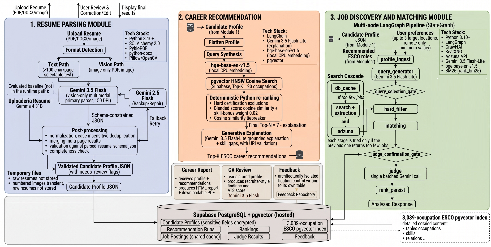

# DiscoverMyRole — An AI-Driven Platform for Smarter Job Search and Career Planning


DiscoverMyRole is a modular, AI-driven platform that turns an uploaded resume into a structured candidate profile, links that profile to matching occupations in the ESCO taxonomy, and then uses those roles to find and rank live job openings.

---

## Table of contents

- [The problem](#the-problem)
- [Goals](#goals)
- [How the system works](#how-the-system-works)
- [Tech stack](#tech-stack)
- [Project layout](#project-layout)
- [Getting started](#getting-started)
- [Credits](#credits)

---

## The problem

Looking for a job today is scattered, slow, and mostly done by hand. Many candidates are unsure which roles actually fit their experience, and they spend a lot of time adjusting resumes, drafting cover letters, searching for suitable openings, and looking up recruiters across different websites — with no intelligent tool to guide or automate any of these steps.

## Goals

1. Pull structured candidate information out of uploaded resumes
2. Suggest career paths and job roles that fit the candidate's background
3. Find relevant job postings and rank them against the candidate's profile
4. Present a single summary report covering suggested career paths, matched jobs, and recommended next steps

## How the system works

The platform is made up of three modules that share one candidate profile and one database:

- **Resume Parsing** — Each page of the resume is sent to a vision-first parser. Gemma 4 31B (multimodal) is the main model, while Gemini 2.5 Flash-Lite acts as the backup and repair model. The output is checked against a schema, results from multiple pages are combined and deduplicated, and sensitive fields are encrypted before being stored. If schema validation fails, the module retries once with the backup model; if that also fails, it returns a partial profile marked for review instead of rejecting the request.

- **Career Recommendation** — The candidate profile is converted into a single query and embedded locally on CPU using BAAI/bge-base-en-v1.5 (768 dimensions). The 20 closest ESCO occupations are fetched from a Supabase pgvector index (HNSW, cosine distance), then narrowed to the top 5 by combining semantic similarity with direct skill overlap. Gemini 2.5 Flash-Lite then writes an explanation for each suggestion, using only the retrieved evidence — it can reference only occupations and skills that were actually returned, and every occupation URI is checked before the response is sent.

- **Job Discovery and Matching** — A LangGraph pipeline with seven nodes. It creates search queries from the candidate profile (Gemini 2.5 Flash-Lite), runs them through a self-hosted SearXNG instance, pulls job details with Crawl4AI, removes unsuitable postings using rule-based filters (experience, location), ranks the remaining ones with a mix of BM25 keyword scoring and semantic embedding similarity, and finally has an LLM judge (Gemma 4 31B) score the shortlist. Results are stored in Redis for one hour.



## Tech stack

| Layer | Technologies |
|---|---|
| **Backend** | Python 3.10+, FastAPI, `uv` for dependency management, async SQLAlchemy 2.0 with Alembic migrations |
| **Frontend** | React + TypeScript (Vite) |
| **AI / LLM** | LangChain (Career Recommendation), LangGraph (Job Discovery, 7-node `StateGraph`), Gemini API, Gemma (open-weight, multimodal) |
| **Embeddings & retrieval** | BAAI/bge-base-en-v1.5 (runs locally on CPU), Supabase Postgres with pgvector (HNSW, cosine index) |
| **Job discovery** | SearXNG (self-hosted search), ADZUNA, Crawl4AI (content extraction), BM25 (`rank_bm25`, keyword ranking), Redis (results cache) |
| **Deployment** | Docker Compose |

## Project layout

```
.
├── backend/              Home of all core backend modules
├── frontend/             React + TypeScript web client
├── data/                 Datasets for training and evaluation
├── docs/                 Milestone reports and other documentation
├── notebooks/            Notebooks for exploration and preprocessing
└── docker-compose.yml    Local stack that mirrors production
```

---

## Getting started

### Live version

A hosted version of the app runs on AWS EC2 at **http://13.233.32.61:8080/**.

### Running locally

This section walks through the full first-time setup, the optional Docker route, and the quick commands you'll use to start the app on later days.

#### Requirements

Make sure all of the following are installed before you begin.

| Requirement | Notes |
|---|---|
| **Python 3.12+** | https://python.org — on Windows, check "Add to PATH" during install |
| **uv** | `pip install uv` (Python package manager) |
| **Node.js LTS** | https://nodejs.org — pick the LTS release, not Current |
| **Docker Desktop** | https://docker.com/products/docker-desktop — needs to be running |
| **Git** | https://git-scm.com — needed if you plan to clone the repository |

> **Note:** Make sure Docker Desktop is open and running before launching SearXNG in Step 4. On Windows, check that the system tray shows "Engine running".

#### First-time setup (uv / local)

**Step 1: Clone the repository.** Open a terminal wherever you want the project to live and run:

```bash
git clone https://github.com/<your-username>/DiscoverMyRole.git
```

**Step 2: Move into the project folder.**

```bash
cd DiscoverMyRole
```

**Step 3: Set up the backend environment file.**

1. Switch to the backend folder and create your `.env` file:

   ```bash
   cd backend

   copy .env.example .env    # Windows
   cp .env.example .env      # Mac / Linux
   ```

2. Open `backend/.env` and provide the values below (use `.env.example` as a reference):

   | Variable | Value |
   |---|---|
   | **GOOGLE_API_KEY** | Get one at https://aistudio.google.com/apikey |
   | **SUPABASE_URL** | Your Supabase project URL (Settings > API) |
   | **SUPABASE_SERVICE_KEY** | The service role key (Settings > API) |
   | **SUPABASE_DB_URL** | `postgresql://postgres.<ref>:<password>@...pooler.supabase.com:6543/postgres` |
   | **DATABASE_URL** | Same host as above, but starting with `postgresql+asyncpg://` |
   | **PROFILE_ENCRYPTION_KEY** | Create once using the command below |
   | **SEARXNG_URL** | `http://localhost:8888` (once SearXNG is running in Step 4) |

   To generate the encryption key, run:

   ```bash
   python -c "from cryptography.fernet import Fernet; print(Fernet.generate_key().decode())"
   ```

   > **Important:** `SUPABASE_DB_URL` has to use port `6543`.
   >
   > **Important:** `DATABASE_URL` has to begin with `postgresql+asyncpg://`, not `postgresql://`, because async SQLAlchemy depends on the `+asyncpg` driver.

**Step 4: Launch SearXNG.**

Job Discovery relies on SearXNG as its self-hosted search engine. The first run creates the container; after that you only need to start it.

First run only:

```bash
docker run -d --name searxng-v1 --restart unless-stopped ^
  -p 8888:8080 ^
  -v "%CD%\searxng:/etc/searxng" ^
  searxng/searxng:latest
```

Every run after that:

```bash
docker start searxng-v1
```

To check it's working, visit http://localhost:8888 — you should see the SearXNG search page.

> **Note:** Port 8888 is chosen on purpose, since port 8080 is reserved by Windows on some machines.

**Step 5: Apply database migrations.**

This sets up every database table.

```bash
cd backend
uv run alembic upgrade head
```

**Step 6: Launch the backend.**

```bash
uv run uvicorn main:app --reload
```

To confirm, open http://localhost:8000/health — the response should be `{"status":"ok"}`.

> **Important:** Run uvicorn from inside `backend/`, not from the repository root, because the `data/` folder and module imports are resolved relative to `backend/`.

**Step 7: Launch the frontend.**

In a second terminal, run:

```bash
cd frontend
npm install
npm run dev
```

Then visit http://localhost:5173.

> **Note:** You only need `npm install` the first time, or whenever pulled changes modify `package.json`.

**Step 8: Check that everything works.**

With the server running, execute the following from `backend/`:

```bash
uv run pytest          # expect: 74 passed
uv run lint-imports    # expect: 11 kept, 0 broken
```

And this from `frontend/`:

```bash
npx eslint .            # expect: exit 0, no errors
```

#### Running with Docker (one command)

If you'd rather not install Python or Node on your machine, Docker Compose can run the whole stack in containers — database, SearXNG, migrations, backend, and frontend.

**Setup**

1. Create and fill in the environment file as explained in Step 3.
2. From the repository root, run:

   ```bash
   docker compose up --build
   ```

3. Visit http://localhost:8080. The app is ready once every service reports as healthy.

**Things to know**

- The first build pulls the Python and Node base images and installs all dependencies, so it can take a few minutes. Later starts are much quicker.
- Migrations are applied automatically each time the backend container starts.
- SearXNG runs inside Docker on internal port 8080, so there's no need to start the standalone container from Step 4.

> **Important:** Don't run `docker compose up` alongside the local `uvicorn` server — both use port 8000 and will clash.

---

### Starting the app after initial setup

#### uv setup

After the first-time setup, getting the app running again only takes three commands in three separate terminals:

**Terminal 1 — SearXNG**

```bash
docker start searxng-v1
```

**Terminal 2 — Backend**

```bash
cd backend
uv run uvicorn main:app --reload
```

**Terminal 3 — Frontend**

```bash
cd frontend
npm run dev
```

Then visit http://localhost:5173.

#### Docker setup

```bash
docker compose up
```

---

## Credits

Made by Ruponti Muin Nova.
